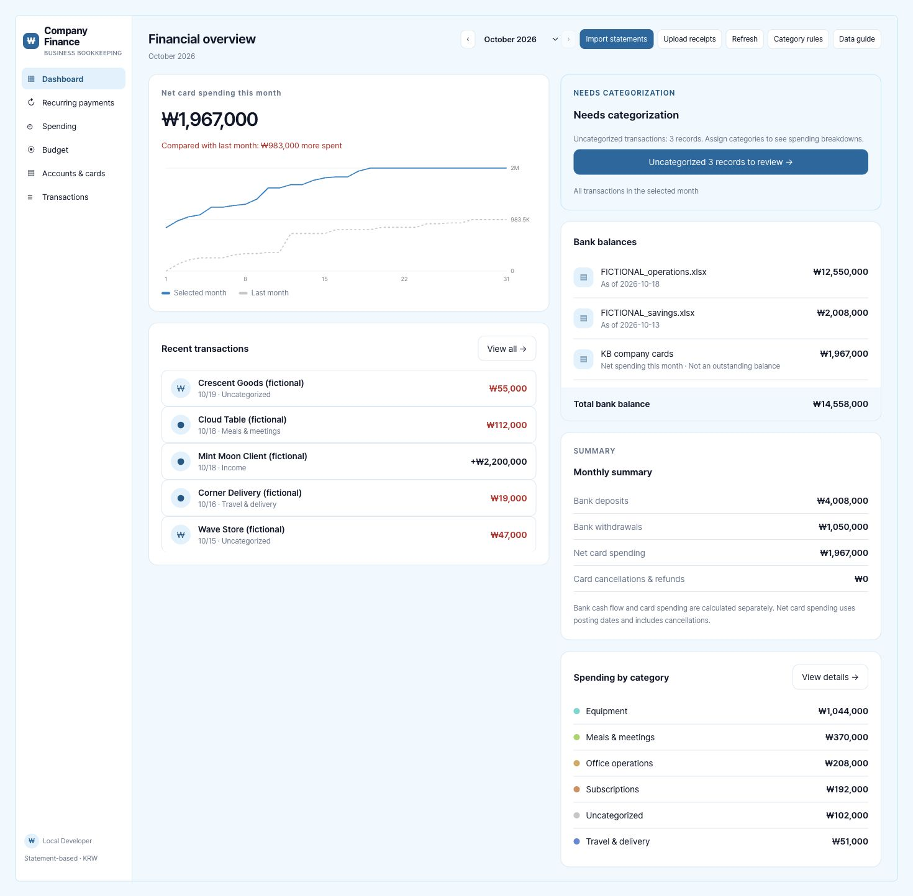
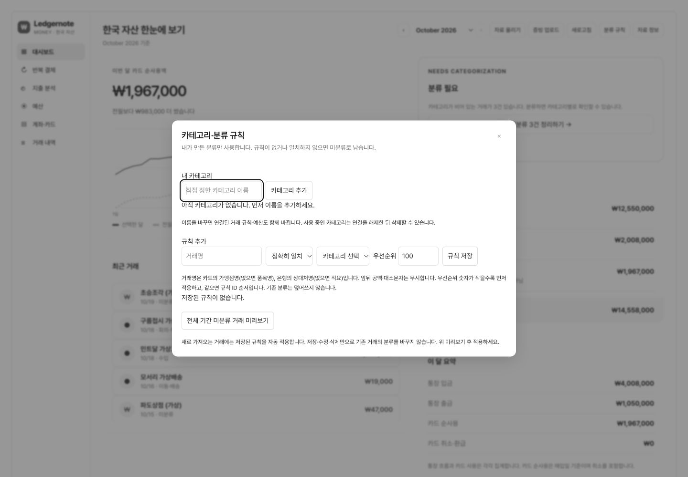

# Company Finance

소규모 기업을 위한 명세서 기반 장부 관리 서비스입니다. 은행·카드 거래를 가져오고, 직접 분류와 규칙을 정의하고, 지출·잔액·정기 결제·예산을 확인할 수 있습니다.

[English](README.md) · 한국어

[빠른 시작](#빠른-시작) · [필수 준비 사항](#필수-준비-사항) · [데이터 형식](#지원하는-데이터) · [독립 호스팅](docs/SELF-HOSTING.md) · [기여 안내](CONTRIBUTING.md)



*실제 로컬 서비스에서 가상 시연 데이터를 사용한 화면입니다. 설치 시 데이터베이스는 비어 있으며, 예시 데이터를 자동으로 넣지 않습니다.*

## 빠른 시작

**Git, Node.js 22.13 이상, npm**을 준비하세요.

```sh
git clone https://github.com/dpwld/company-finance.git
cd company-finance
npm ci
npm run setup
npm run dev
```

출력된 루프백 주소를 여세요. 기본 주소는 보통 `http://127.0.0.1:5173`입니다. 로컬 개발에는 ChatGPT 계정이나 유료 API 키가 필요하지 않습니다. 설정 과정은 서비스를 빌드하고 저장소에 포함된 로컬 데이터베이스 마이그레이션을 적용하며, 기존 데이터를 덮어쓰거나 예시를 추가하지 않습니다.

먼저 **Category rules**에서 본인의 분류를 만든 뒤, 지원하는 명세서를 가져오고 미리보기를 검토하세요. 저장된 규칙은 새 거래를 자동으로 분류합니다. 기존 거래는 사용자가 명시적으로 미리보기를 확인하고 적용해야 변경됩니다.

업데이트와 문제 해결은 [설치 안내](docs/INSTALLATION.md)를, 본인의 Cloudflare 리소스와 인증 설정은 [독립 호스팅 안내](docs/SELF-HOSTING.md)를 참고하세요. 직접 배포할 때는 작성자의 호스팅된 서비스나 Site ID가 필요하지 않습니다.

## 필수 준비 사항

| 의존 항목 | 용도 | 없을 때의 동작 |
|---|---|---|
| D1 `DB` 바인딩 | 거래, 분류, 규칙, 예산, 설정 | 필수. 로컬 설정 과정에서 에뮬레이션 데이터베이스를 준비 |
| R2 `BUCKET` 바인딩 | 영수증 업로드 및 다운로드 | 기본 장부 기능은 동작하며, 파일 작업 시 저장소 미설정 오류 표시 |
| 운영 환경 인증 | 사용자별 데이터 구분 | 독립 배포에서는 Cloudflare Access, Sites에서는 Sites 인증 사용 |
| 본인의 분류와 규칙 | 분류 및 예산 | 기본 분류나 숨겨진 가맹점 규칙이 없으며, 일치하지 않는 거래는 미분류 상태로 유지 |
| 선택 사항인 `OPENAI_API_KEY`, `OPENAI_MODEL` | 명시적으로 요청한 AI 분류 제안 | AI 없이도 수동 분류와 정해진 규칙에 따른 분류 사용 가능 |

선택적 API를 설정할 때만 [`.env.example`](.env.example)을 Git에서 제외되는 `.dev.vars`로 복사하세요. 본인의 인증 정보를 추가한 뒤 로컬 서버를 다시 시작하세요. 운영 환경의 비밀값은 배포 제공업체의 비밀값 저장소에 넣어야 하며, 브라우저 변수에 넣으면 안 됩니다.

## 지원하는 데이터

화면은 영어입니다. 원본 거래 기록의 언어와 통화는 유지합니다. 이 버전은 **아래 한국어 원본 헤더를 사용하는 원화 명세서**를 지원하며, 은행이나 세무 계정에 직접 연결하지 않습니다.

| 출처 | 파일 형식 및 예상 필드 |
|---|---|
| KB 카드 명세서 | `승인일`, `가맹점명`, `합계` 또는 `승인금액`이 있는 XLSX, XLS, CSV. 승인번호가 있으면 중복 감지에 사용합니다. 확인할 수 없는 원화 금액은 `null`로 유지합니다. |
| KB 은행 명세서 | `거래일시`, `출금액`이 있는 XLSX, XLS, CSV. 단위 접미사도 허용합니다. 입금액, 거래 상대방, 설명, 선택적인 잔액도 읽습니다. 원본 파일명으로 계좌를 구분합니다. |
| 홈택스 세금계산서 | `작성일자`, `공급가액` 또는 `합계금액`이 있는 XLSX, XLS, CSV. 세액, 거래 상대방, 승인번호도 읽습니다. 파일명이나 시트명에 `매출` 또는 `매입`을 포함하세요. 저장 데이터와 JSON 백업에 포함됩니다. |
| 영수증 | 20 MB 미만의 PDF, 이미지, 오피스 문서. 파일명을 바탕으로 제안하는 연결 거래는 사용자가 검토하고 확정해야 합니다. |

헤더 별칭과 형식 감지 로직은 [`lib/finance/parse.ts`](lib/finance/parse.ts)에 있습니다. 임의 형식의 CSV를 자동으로 해석하지 않습니다. 기업별로 추가한 분류 열은 무시하며, 분류는 본인의 규칙이나 직접 수정한 값을 사용합니다.

## 작업 흐름

| 영역 | 할 수 있는 작업 |
|---|---|
| 대시보드 | 순 카드 지출, 추이, 미분류 거래, 은행 잔액, 최근 거래 확인 |
| 정기 결제 | 3개월 이상에 걸쳐 나타나는 가맹점을 찾고 실제 결제 이력 확인 |
| 지출 | 분류별 비중, 전월 비교, 최근 6개월 추이 확인 |
| 예산 | 월별 분류 한도를 저장하고 순 카드 지출과 비교 |
| 계좌 및 카드 | 원본 파일별 계좌 잔액과 국내·해외 카드 지출 확인 |
| 거래 | 여러 달에 걸친 검색·필터, CSV 내보내기, 메모·분개 필드 수정, 분류, 분할, 영수증 연결 |
| 분류 및 규칙 | 분류 생성·이름 변경·삭제. 정확히 일치하거나 일부를 포함하는 규칙 생성·수정·삭제. 과거 미분류 거래에 대한 적용 결과 미리보기 및 적용 |

**계산 범위.** 카드 지출은 거래 반영 월을 기준으로 계산하며, 해당 정보가 없으면 승인일을 사용합니다. 환불과 취소에 따른 음수 금액도 포함합니다. 확인할 수 없는 원화 금액은 합계에서 제외합니다. 카드 결제 대금이 두 번 집계되지 않도록 은행 현금 흐름은 별도로 유지합니다. 원본 파일명이 다르면 별도 계좌로 취급합니다.

**규칙 동작.** 규칙은 가맹점명이나 거래 상대방 이름을 비교하며, 없으면 품목명이나 설명을 사용합니다. 비교할 때 대소문자와 앞뒤 공백은 무시합니다. 우선순위 숫자가 낮은 규칙부터 실행하며, 같으면 규칙 ID 순서를 따릅니다. 수동으로 지정한 분류는 유지합니다. 분류 이름을 바꾸면 연결된 거래, 분할 내역, 규칙, 예산도 갱신합니다. 사용 중인 분류는 연결을 해제하기 전까지 삭제할 수 없습니다. 선택적 AI 기능은 저장된 거래와 분류만 대상으로 하며, 적용 전에 검토해야 합니다.



*가상의 분류와 거래명을 사용했습니다. 기업의 실제 규칙이나 업무 데이터는 포함되어 있지 않습니다.*

## 예시 스크린샷

**5182번 포트**에서 격리된 로컬 미리보기를 사용하세요. 예시 생성 도구는 호스팅된 URL을 거부하고, 생성된 ID를 기록하며, 기존 데이터와 충돌하면 실행을 거부합니다.

```sh
npm run dev -- --port 5182
# 다른 터미널에서 실행:
node scripts/seed-fictional-finance.mjs seed http://127.0.0.1:5182
node scripts/seed-fictional-finance.mjs status http://127.0.0.1:5182
# 도구가 기록한 예시 데이터만 삭제:
node scripts/seed-fictional-finance.mjs cleanup http://127.0.0.1:5182
```

예시에는 카드 거래 30건, 은행 거래 9건, 분류 6개, 규칙 9개, 예산 5개가 포함됩니다. 이름은 모두 가상이며, 실제 계좌번호, 연락처, 식별자는 사용하지 않습니다. Git에서 제외되는 `.sites-runtime/fictional-finance-manifest.json`이 정리할 데이터를 추적하므로 정리가 끝날 때까지 보관하세요.

## 개발 및 검증

```sh
npm run typecheck
npm test
node --test tests/deployment-auth.test.mjs tests/deployment-config.test.mjs
npm run build
# 로컬 개발 서버가 5182번 포트에서 실행 중일 때:
node scripts/test-http.mjs
```

React/Vinext 화면 → 인증된 API → 소유자별 D1 데이터 구조입니다. R2 파일에도 소유자 검사를 적용합니다. 테스트는 실제 임시 D1의 영구 저장, 규칙 우선순위·미리보기·적용, 중복 가져오기, 유효하지 않은 입력 거부 시 기존 데이터 유지, 원자적 필드 갱신, 거래 분할, 세금계산서 무결성, 잔액, 원본 명세서 파서를 검증합니다. HTTP 점검은 로그인 요구, 허용되지 않은 오리진 거부, D1 변경, R2 파일 바이트를 확인하고 테스트 데이터를 정리합니다. 유료 AI 호출은 QA에 포함되지 않습니다.

핵심 화면 6개에는 연구지원금 재무 업무가 포함되지 않습니다. [기능 범위](docs/FEATURE-PARITY.md)와 [구현 보고서](docs/IMPLEMENTATION-REPORT.md)를 참고하세요. 계정 간 팀 공유, 실시간 은행 연결, 임의의 다중 통화 장부 관리는 구현되어 있지 않습니다. 코드를 재사용할 때는 [원본 고지](THIRD_PARTY_NOTICES.md)와 함께 제공된 외부 구성 요소의 고지를 보존하세요.
